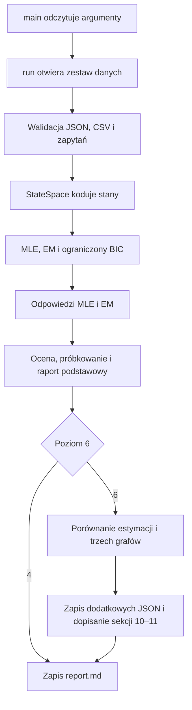

# Jak działa kod projektu sieci bayesowskiej studentów

Pakiet `student_bn` wczytuje opis sieci i dane studentów, uczy modele, odpowiada na zapytania i zapisuje wyniki. Graf sieci przechowuje zależności między zmiennymi, a tablice CPD przechowują liczby. To rozróżnienie pozwala porównać kilka sposobów wyznaczania liczb dla tego samego grafu i kilka różnych grafów przy wspólnej metodzie estymacji.

## Mapa plików

| Plik | Odpowiedzialność |
|---|---|
| [`__init__.py`](student_bn/__init__.py) | Oznacza katalog `student_bn` jako pakiet Pythona. Plik jest pusty. |
| [`__main__.py`](student_bn/__main__.py) | Obsługuje polecenie `python -m student_bn` i steruje kolejnością obliczeń. |
| [`data.py`](student_bn/data.py) | Zamienia opis JSON w obiekt `Description`, a CSV w ramki danych z walidacją. |
| [`joint.py`](student_bn/joint.py) | Koduje stany liczbami, buduje tablicę rozkładu łącznego, sumuje po osiach i generuje próbki. |
| [`learning.py`](student_bn/learning.py) | Estymuje tablice CPD metodami MLE i EM dla zadanego grafu. |
| [`structure.py`](student_bn/structure.py) | Uczy krawędzi przez Hill Climb z BIC, imputuje braki i porównuje grafy. |
| [`queries.py`](student_bn/queries.py) | Parsuje zapytania `P` i `MAP`, sprawdza AST i oblicza odpowiedzi. |
| [`evaluation.py`](student_bn/evaluation.py) | Ocenia modele, oblicza miary i porównuje rozkłady. |
| [`report.py`](student_bn/report.py) | Formatuje wyniki, oblicza zestawienia do raportu i zapisuje odpowiedzi w JSON-ie. |

## Uruchomienie i kolejność wywołań

Polecenie uruchamia `student_bn/__main__.py`. Po wejściu do katalogu `sieci_bayesowskie/projekt_3` można zachować dwa przebiegi w osobnych katalogach.

```powershell
$env:PYTHONHASHSEED = "0"
py -3.11 -m student_bn --level 4 --output results/4_pkt
py -3.11 -m student_bn --level 6 --output results/6_pkt
```

`PYTHONHASHSEED=0` stabilizuje kolejność zależną od haszy napisów. Może ona mieć znaczenie przy remisach w wyszukiwaniu grafu. Argument `--seed` steruje generatorami NumPy używanymi w losowych startach EM, imputacji i próbkowaniu. Przy tym samym modelu i ziarnie próbki są powtarzalne, a kolejność losowania zmiennych przy remisie topologicznym ustala kolejność z opisu danych.



### `main()` i argumenty

Instrukcja `if __name__ == "__main__"` wywołuje `main()` przy uruchomieniu modułu. Funkcja oblicza ścieżkę katalogu projektu na podstawie `__file__` i używa `argparse`. Następnie przekazuje argumenty do `run()`. Po sukcesie wypisuje ścieżkę raportu i informację o JSON-ach. Przy `ValueError` lub `ArithmeticError` wypisuje komunikat na standardowe wyjście błędów i kończy z kodem `2`. `run()` można też wywołać bezpośrednio z Pythona i otrzymać obiekt `Path` prowadzący do raportu.

| Argument | Domyślnie | Znaczenie |
|---|---|---|
| `--dataset` | `data/k26` względem projektu | Katalog z pięcioma plikami wejściowymi. |
| `--output` | `results` względem projektu | Miejsce zapisu raportu i JSON-ów. Użycie tej samej ścieżki w kolejnych przebiegach nadpisze pliki o tych samych nazwach. |
| `--level` | `6` | Wybiera poziom `4` albo `6`. |
| `--em-iterations` | `100` | Limit aktualizacji w pojedynczym uruchomieniu EM. |
| `--em-starts` | `5` | Liczba losowych startów na grafie eksperckim w wariancie `6`. Minimum wynosi `5`. |
| `--imputation-rounds` | `2` | Liczba rund iteracyjnego uczenia struktury w wariancie `6`. Minimum wynosi `1`. |
| `--samples` | `20000` | Rozmiar jednej partii próbek do porównania w raporcie. `0` pomija próbkowanie. |
| `--seed` | `42` | Ziarno używane do tworzenia losowych startów, rund imputacji i próbek. |

### Wspólny przebieg `run()`

1. `load_description()` czyta `opis.json`. `load_csv()` czyta `dane.csv` do `train` i `test.csv` do `test`. Drugi odczyt ma `complete=True` i wymaga pełnych wierszy. `train` dostarcza obserwacji do uczenia. `test` służy do oceny gotowych modeli i porównania z częstościami empirycznymi.
2. `load_queries()` czyta `zapytania.txt` w trybie zwykłym i `ograniczenia.txt` w trybie zaawansowanym. `StateSpace.from_description()` tworzy wspólną kolejność zmiennych i stanów dla obliczeń.
3. `fit_mle()` buduje model ekspercki i model niezależny z `edges=[]`. Na grafie eksperckim program dopasowuje także EM. Poziom `4` wykonuje jeden start z lekko wygładzonego MLE. Poziom `6` wykonuje wiele startów losowych i używa zwycięzcy już w podstawowej części raportu. `learn_bic_structure()` uczy trzeci graf na pełnych wierszach z ograniczeniami i dopasowuje na nim CPD przez rodzinne MLE.
4. Program tworzy katalog wyjściowy. Dla eksperckiego MLE i eksperckiego EM buduje osobny rozkład łączny i osobną instancję `VariableElimination`, następnie wywołuje `solve_query()` dla obu list zapytań. Zapisuje `answers_mle.json` i `answers_em.json`. Na `k26` każdy zawiera 19 zapytań zwykłych i 9 logicznych.
5. `majority_grade()` wybiera najczęstszą ocenę `G` w danych uczących. Zagnieżdżona funkcja `score(model)` wywołuje `evaluate_model()` z bieżącym zbiorem oceny, przestrzenią stanów i tą oceną awaryjną. Program liczy miary dla `MLE`, `EM`, `BIC learned` i `Independent`. `sampling_comparison()` używa eksperckiego MLE i maksymalnie trzech pierwszych zapytań logicznych. `make_report()` składa podstawową część raportu.

### Co dochodzi dla `--level 6`

1. **Porównanie estymatorów na jednym grafie.** `fit_mle(description, train.dropna())` dopasowuje model ekspercki na pełnych wierszach. Rodzinne MLE i najlepszy EM są już gotowe. Na `k26` `train` ma 2000 wierszy, a `train.dropna()` ma 367.
2. **Trzy sposoby uzyskania grafu.** `learn_dag(..., constrained=False)` uczy graf na pełnych wierszach bez ograniczeń. Graf z ograniczeniami z tej samej podpróby jest dostępny jako `learned.edges`. `iterative_structure_learning()` tworzy trzeci graf przez pętlę imputacji i uczenia, startując od eksperckiego EM.
3. **Wspólne dopasowanie parametrów dla trzech wyuczonych grafów.** Dla dwóch grafów z pełnych wierszy program oblicza rodzinne MLE na oryginalnym `train` jako punkt wyjścia i uruchamia `fit_em()`. Dla trzeciego bierze `imputation_steps[-1].em.model`, bo ostatnia runda wykonała już tę samą procedurę. Model `BIC learned` w podstawowej tabeli ma rodzinne MLE. Wariant `HC (complete, expert)` w rozszerzeniu korzysta z tych samych krawędzi i z nowo dopasowanych CPD metodą EM.
4. **Dodatkowe odpowiedzi i raport.** Dla pełnego MLE i trzech wyuczonych struktur program rozwiązuje zwykłe zapytania i zapisuje `answers_mle_complete.json`, `answers_structure_free.json`, `answers_structure_expert.json` i `answers_structure_em_imputed.json`. `make_six_point_report()` otrzymuje modele, metryki, listy krawędzi, historię rund i odpowiedzi. Zwracane sekcje 10–11 są dopisywane do tekstu podstawowego.

Ostatnim krokiem obu wariantów jest zapis jednego `report.md` w UTF-8. Domyślne próbkowanie daje podstawowej części sekcje 1–9. Gdy `--samples 0`, sekcja 8 jest pomijana. Flaga `--level 4` w obecnym kodzie nadal uruchamia wspólny EM, ograniczony BIC i obliczenia dla zapytań logicznych. Flaga `--level 6` dodaje pełne porównania, a `answers_em.json` może różnić się między przebiegami z powodu innej inicjalizacji EM.

## `data.py` i kontrakt danych wejściowych

**`Variable`** przechowuje pole `description` i uporządkowaną krotkę `states`. **`Description`** przechowuje słownik zmiennych, trzy zbiory krawędzi zapisane jako krotki, warstwy czasowe `tiers` i nazwę zestawu `name`. Obie klasy są zadeklarowane jako `@dataclass(frozen=True)`, co blokuje przypisanie nowej wartości do pola instancji. Właściwość **`Description.states`** buduje mapę `nazwa zmiennej → krotka stanów`, używaną np. przy deklarowaniu CPD i kodowaniu danych.

### Czytanie i sprawdzanie `opis.json`

- **`_check_name(name, where)`** sprawdza, czy identyfikator jest napisem zaczynającym się literą ASCII i złożonym z liter, cyfr lub `_`. Odrzuca słowa kluczowe Pythona oraz `P`, `MAP`, `atleast`, `atmost`. `where` trafia do komunikatu z lokalizacją identyfikatora.
- **`_read_description_document(path)`** czyta UTF-8 z opcjonalnym BOM-em i wywołuje `json.loads()`. Błąd składni JSON przekazuje jako `ValueError` z plikiem, linią i kolumną. Sprawdza też, czy korzeń dokumentu jest obiektem, oraz czy zestaw pól zgadza się ze schematem. `meta` jest opcjonalne.
- **`_parse_variables(raw, path)`** wymaga niepustego obiektu `variables`. Dla każdej zmiennej sprawdza nazwę oraz pola `description` i `states`. Opis ma być napisem, a lista stanów ma mieć przynajmniej dwa poprawne, różne identyfikatory. Wynik to słownik obiektów `Variable`, z kolejnością zmiennych i stanów przejętą z JSON-a.
- **`_edges(value, where, nodes)`** waliduje listę par `[źródło, cel]`. Oba końce muszą należeć do `nodes`. Pętla własna i powtórzenie tej samej pary kończą się błędem. Funkcja zwraca krotkę par w kolejności wejściowej. Reguły dotyczące cykli i konfliktów zależą od rodzaju listy i są sprawdzane później.
- **`_parse_tiers(tiers, path, nodes, directed_edges)`** wymaga niepustej listy niepustych warstw. Każda zmienna musi wystąpić dokładnie raz. Buduje mapę `zmienna → numer warstwy`, po czym sprawdza, czy krawędzie eksperckie i wymagane nie biegną z późniejszej warstwy do wcześniejszej. Krawędzie w obrębie jednej warstwy są dozwolone. Wynikiem jest krotka krotek nazw.
- **`load_description(path)`** wiąże te etapy. Po wczytaniu dokumentu i zmiennych pobiera listy `expert_edges`, `required_edges` oraz `forbidden_edges`. Sprawdza rozłączność wymaganych i zabronionych krawędzi. Dla krawędzi eksperckich oraz wymaganych buduje grafy NetworkX i sprawdza ich acykliczność. Na końcu weryfikuje warstwy, pobiera tytuł z `meta.description` z domyślnym `dataset` i zwraca `Description`.

### CSV i statystyki

**`load_csv(path, description, complete=False)`** korzysta z `csv.reader` w trybie ścisłym, aby zachować numery linii w komunikatach. Nagłówek musi zawierać dokładnie opisane zmienne, bez duplikatów. Kolejność kolumn w pliku jest dowolna. Każdy wiersz musi mieć tyle samo pól co nagłówek. Wypełnione pole musi być dozwolonym stanem danej zmiennej. Puste pole staje się `np.nan`, a przy `complete=True` powoduje błąd. Pusty zbiór jest odrzucany. Przed zwróceniem ramki kolumny są ustawiane w kolejności z `Description`.

**`data_statistics(frame)`** liczy wszystkie wiersze, wiersze z kompletem obserwacji i udział wartości pustych w każdej kolumnie. Wyniki są wykorzystywane przez `make_report()`. Rodzinne MLE potrzebuje kompletu tylko w kolumnach jednej rodziny, więc liczba 367 pełnych wierszy nie wyznacza liczby obserwacji używanych do każdej jego CPD.

## `joint.py` i tablica rozkładu łącznego

**`StateSpace`** łączy kolejność zmiennych, słownik stanów i macierz `assignments`. Każdy jej wiersz opisuje jedną kompletną konfigurację, a każda kolumna jedną zmienną. Etykiety `Easy` i `Hard` mogą być reprezentowane przez `0` i `1`, zgodnie z ich kolejnością w `opis.json`. W `k26` jest osiem zmiennych dwustanowych oraz trójstanowe `G`, więc pełna przestrzeń ma `2⁸ × 3 = 768` wierszy. Dzięki temu mały rozkład można obliczyć dokładnie dla każdej konfiguracji.

- **`StateSpace.from_description()`** bierze zmienne w kolejności dokumentu i tworzy iloczyn kartezjański zakresów kodów ich stanów. Zamienia go na dwuwymiarową tablicę NumPy.
- **`cardinalities`** zwraca krotkę liczby stanów w kolejności `variables`. Określa kształt wielowymiarowej tablicy łącznej. **`positions`** zwraca mapę `zmienna → indeks kolumny`, potrzebną do wyboru osi.
- **`encode(frame, missing=-1)`** mapuje etykiety każdej kolumny na liczby całkowite i zastępuje braki znacznikiem `-1`. Kolumny scala w macierz. Funkcja pracuje na danych wcześniej zwalidowanych przez `load_csv()` i wykorzystuje ich etykiety także po próbkowaniu.
- **`cpd_values(cpd)`** bierze wartości CPD od `pgmpy` i wyrównuje kolejność stanów osobno dla każdej osi według nazwy zmiennej. Używa `cpd.variables` dla kolejności osi oraz `cpd.state_names` dla kolejności stanów. Układ osi CPD jest zachowany, a kody z `assignments` wskazują dzięki temu właściwe elementy.
- **`probability_table(model)`** zaczyna od wektora jedynek. Dla każdej CPD wybiera z każdej konfiguracji stan zmiennej i stany rodziców, pobiera odpowiadające im wartości i mnoży je przez bieżący wektor. Wynikiem jest `P(x)` dla każdego pełnego `x`, zgodnie z faktoryzacją `P(x) = ∏ P(xᵢ | rodzice xᵢ)`.
- **`marginal(weights, variables)`** wybiera kolumny żądanych zmiennych, oblicza płaski indeks każdej kombinacji i sumuje wagi przez `np.bincount()`. Dla wag z pełnego rozkładu daje rozkład brzegowy. Jeśli wagi niepasujących konfiguracji wyzerowano, wynik daje masę wspólną ze zdarzeniem i można go podzielić przez prawdopodobieństwo tego zdarzenia.
- **`probability_of_rows(joint, frame)`** koduje pełne wiersze, zamienia kody na płaskie indeksy `np.ravel_multi_index()` i odczytuje prawdopodobieństwo każdego wiersza z `joint`. To ścieżka używana do `test.csv`.
- **`samples(model, size, seed)`** losuje w porządku topologicznym, więc wszyscy rodzice są już wylosowani, gdy przychodzi czas na dziecko. Z kodów rodziców wyznacza kolumnę CPD dla każdej próbki, liczy skumulowane prawdopodobieństwa i porównuje je z liczbami jednostajnymi. Dla jednej zmiennej przetwarza od razu całą partię. Na końcu dekoduje kody do etykiet i zwraca `DataFrame`.

Przykładowo przy rozkładzie `G` równym `[0,5; 0,2; 0,3]` dystrybuanta ma progi `[0,5; 0,7; 1,0]`. Losowanie `u = 0,62` przekracza jeden próg i daje indeks `1`, czyli stan `B`. Wektorowe porównanie progów realizuje ten sam wybór dla wszystkich wierszy partii.

## `learning.py` i estymacja parametrów

W grafie eksperckim `G` ma rodziców `D`, `I` i `Q`. CPD `G` koduje rozkład oceny oddzielnie dla każdej kombinacji tych trzech zmiennych. Ma trzy stany oceny i osiem konfiguracji rodziców, czyli 24 komórki. W każdej konfiguracji suma prawdopodobieństw wynosi 1, więc ta CPD ma 16 swobodnych parametrów. Podanie innego grafu może zmienić liczbę i znaczenie kolumn CPD.

### Tworzenie grafu i MLE

**`empty_network(description, edges)`** tworzy `DiscreteBayesianNetwork` z podanymi krawędziami i dodaje wszystkie zadeklarowane węzły, również izolowane. W przypadku `edges=[]` każda zmienna ma samodzielny rozkład brzegowy. To podstawa modelu niezależnego.

**`fit_mle(description, data, edges=None)`** domyślnie używa grafu eksperckiego. Przekazuje `DiscreteMLE` pełne listy stanów z opisu i wywołuje `estimator.fit(model, data)`. Dodaje oszacowane CPD do modelu, sprawdza je przez `model.check_model()` i zwraca gotową sieć. Rodzinne MLE liczy udział `N(X=x, Pa(X)=u) / N(Pa(X)=u)` wśród wierszy z kompletną rodziną `X`. Przykładowo brak `L` sam w sobie nie wyklucza wiersza z wyliczenia CPD dla `G`. MLE na pełnych wierszach używa tego samego kodu z `train.dropna()` przekazanym jako dane.

**`largest_cpd_info(description, model, data)`** wybiera CPD z największą liczbą komórek. Wylicza wszystkie konfiguracje rodziców i porównuje je z konfiguracjami obserwowanymi w wierszach, gdzie dziecko i rodzice są kompletni. Zwraca nazwę zmiennej, rodziców, kształt, liczbę komórek, stany, liczbę nieobserwowanych konfiguracji i ewentualny przykład z rozkładem odczytanym z CPD. Wynik służy do rozdziału raportu o grafie eksperckim.

### `_em_parameters()` i kolejne iteracje EM

Funkcja przyjmuje dane, sieć początkową, limit iteracji, tolerancję oraz typ i ziarno inicjalizacji. Zwraca słownik tablic parametrów oraz historię log-wiarygodności obserwacji. Graf określa rodziców każdej zmiennej przez cały przebieg EM.

1. **Grupowanie wierszy.** `space.encode(data)` koduje dane. `np.unique(..., axis=0, return_counts=True)` łączy identyczne wzorce obserwacji i zachowuje ich częstości. Macierz `matches` ma po jednym wierszu na wzorzec i po jednej kolumnie na pełną konfigurację. Pozycja ma wartość `True`, jeśli każda znana współrzędna wzorca zgadza się z konfiguracją. Brak `-1` pasuje do dowolnego stanu.
2. **Przygotowanie indeksów rodzin.** Dla każdej CPD kod zapisuje `shape`, indeksy stanów dziecka i rodziców dla każdego pełnego przypisania oraz płaskie indeksy `flat`. Ten sam zestaw indeksów przydaje się podczas mnożenia CPD i późniejszego agregowania zliczeń.
3. **Inicjalizacja.** Tryb `random` losuje niezależny wektor Dirichleta dla każdej konfiguracji rodziców, po jednym prawdopodobieństwie na stan dziecka. Tryb `mle` stosuje `0,98 × CPD_MLE + 0,02 / liczba_stanów_dziecka` w każdej komórce. Dodatnie prawdopodobieństwa początkowe pozwalają liczyć rozkład a posteriori dla częściowo zaobserwowanych wierszy.
4. **E-krok.** Zagnieżdżone `joint_table()` mnoży bieżące CPD dla wszystkich pełnych konfiguracji. Przemnożenie przez `matches` zostawia masę zgodnych uzupełnień. Suma w wierszu to `p_r`, czyli prawdopodobieństwo obserwacji wzorca. Podzielenie przez `p_r` daje `P(uzupełnienie | obserwacje)`. Kod mnoży wagi przez liczby wystąpień wzorców i sumuje po wzorcach. Powstaje wektor oczekiwanych liczności pełnych konfiguracji.
5. **M-krok.** `np.bincount(flat, weights=expected, ...)` sumuje oczekiwane liczności we właściwych komórkach rodziny. Kod dzieli każdą kolumnę przez jej sumę, a kolumny o sumie zero wypełnia rozkładem jednostajnym. W ten sposób aktualizuje wszystkie CPD.
6. **Kontrola wyniku i stop.** Zagnieżdżone `observed_mass(joint)` sumuje masy zgodnych konfiguracji. Zagnieżdżone `log_likelihood(mass)` oblicza iloczyn skalarny częstości wzorców i logarytmów ich mas, czyli sumę log-wiarygodności obserwowanych części wierszy. Historia zawiera wartość początkową i wartość po każdej aktualizacji. Spadek większy niż `1e-7` powoduje `ArithmeticError`. Funkcja kończy po osiągnięciu limitu lub gdy bezwzględna zmiana log-wiarygodności spadnie poniżej `tolerance × len(data)`.

Przykład jednego niepełnego wiersza. Dwie zgodne konfiguracje mają masy łącznego rozkładu `0,03` i `0,01`. Obserwowany fragment ma masę `0,04`, więc konfiguracje dokładają `0,75` i `0,25` do oczekiwanych zliczeń. Jeśli wzorzec wystąpił cztery razy, wnosi łącznie `3` i `1`. Tę operację program wykonuje również dla wierszy z wieloma brakami. Pełny wiersz ma tylko jedną zgodną konfigurację.

### `fit_em()`, wynik i losowe starty

**`fit_em()`** wywołuje `_em_parameters()`, tworzy nową sieć z tymi samymi krawędziami i zamienia każdą otrzymaną tablicę w `TabularCPD`. Zachowuje kolejność rodziców z CPD modelu wejściowego i bierze kolejność stanów z opisu. Po złożeniu sprawdza model i zwraca **`EMResult`**. Ten obiekt zawiera sieć, historię log-wiarygodności, `converged`, `seed` i nazwę inicjalizacji. Liczba aktualizacji to `len(observed_log_likelihood) - 1`, bo pierwszy punkt opisuje stan startowy.

**`fit_em_multistart()`** wymaga co najmniej pięciu startów. Z jednego głównego ziarna losuje różne ziarna poszczególnych uruchomień. Każde uruchamia przez `fit_em(initialization="random")` z tym samym grafem, tolerancją i limitem. Wybiera indeks największej końcowej log-wiarygodności obserwacji w danych uczących. **`MultiStartEM`** przechowuje wszystkie wyniki `runs` i `best_index`, a właściwość **`best`** zwraca zwycięski `EMResult`. Na `k26` w zapisanym przebiegu wygrywa czwarty start, więc to jego model odpowiada na zapytania oznaczone jako `EM` dla poziomu 6.

## `structure.py` i uczenie krawędzi

**`StructureResult`** grupuje model z dopasowanymi CPD, krawędzie, wynik BIC wyuczonego grafu, BIC grafu eksperckiego i liczbę pełnych wierszy wykorzystanych do wyszukiwania. **`ImputationStep`** zawiera numer rundy, krawędzie wyuczone w tej rundzie i jej `EMResult`.

### Hill Climb z BIC

**`learn_dag(description, complete, constrained=...)`** sprawdza kompletność i niepustość danych oraz zgodność kolumn z opisem. W trybie ograniczonym buduje `ExpertKnowledge` z wymaganych i zabronionych krawędzi oraz warstw. Wywołuje `HillClimbSearch` z `scoring_method="bic-d"` i `return_type="dag"`. Wyszukiwanie lokalnie ocenia dozwolone zmiany struktury. BIC premiuje dopasowanie i uwzględnia karę rosnącą z liczbą swobodnych parametrów. Kod odbiera `hc.causal_graph_`, sprawdza jego węzły i acykliczność, a w trybie ograniczonym ponownie sprawdza wszystkie trzy rodzaje ograniczeń. Zwraca graf gotowy do dopasowania CPD.

Dla danego zbioru wierszy kryterium ma postać `BIC = log L − (k / 2) × log N`, gdzie `k` to liczba swobodnych parametrów, a `N` to liczba wierszy. Dodana krawędź może poprawić dopasowanie i jednocześnie zwiększyć liczbę kolumn CPD dziecka. Hill Climb wybiera ruch na podstawie bilansu tych dwóch składników. Zmiana podpróby zmienia zarówno `log L`, jak i `N`, dlatego raport porównuje BIC ekspercki i wyuczony na wspólnych 367 pełnych wierszach, a trzy warianty struktur porównuje na tych samych danych do oceny przez średnie `log P(wiersza)` i trafność `G`.

**`learn_bic_structure(description, data)`** bierze `data.dropna()` do uczenia grafu ograniczonego. Liczy BIC grafu eksperckiego i wyuczonego na tej samej podpróbie, więc ich różnica ma wspólny punkt odniesienia. Dla wyuczonego grafu estymuje CPD funkcją `fit_mle()` na oryginalnych danych, z wykorzystaniem obserwacji kompletnych w ramach każdej rodziny. Pakuje wyniki do `StructureResult`. To właśnie model `BIC learned` z podstawowego raportu.

### Imputacja i iteracyjne uczenie

**`posterior_imputation(model, incomplete, space, seed=...)`** koduje dane i grupuje identyczne wzorce, zachowując indeksy wierszy. Dla wzorca wybiera zgodne indeksy pełnych konfiguracji, odczytuje ich prawdopodobieństwa łączne i normalizuje przez sumę. Gdy obserwacje mają zerową masę, zgłasza `ValueError`. Następnie losuje po jednej pełnej konfiguracji dla każdego wystąpienia wzorca. Wylosowane konfiguracje zgadzają się z obserwowanymi polami, a brakujące zmienne są rozstrzygane wspólnie. Funkcja zwraca pełną ramkę z etykietami stanów i pierwotną liczbą wierszy.

**`iterative_structure_learning()`** zaczyna od gotowego modelu `start_model`. W rundzie z indeksem `i` imputuje oryginalny `train` z ziarnem `seed + i`, uczy ograniczony DAG z uzupełnionych danych, a następnie dopasowuje rodzinne MLE i EM na nowym grafie z oryginalnych danych z brakami. Zapisuje `ImputationStep` z numerem od 1 i używa świeżo dopasowanego `em.model` przy kolejnej imputacji. Warunek przynajmniej jednej rundy gwarantuje, że `run()` może pobrać ostatni krok. Podział ról jest istotny. Uzupełnione wiersze trafiają do BIC, a przy końcowym dopasowaniu EM braki są nadal traktowane jako nieobserwowane.

### Porównanie grafów

- **`parameter_count(description, edges)`** tworzy listę rodziców dla każdej zmiennej. Dla dziecka o `r` stanach liczy `r - 1` swobodnych wartości na konfigurację rodziców i mnoży to przez liczbę ich konfiguracji. Potem sumuje wkład po wszystkich zmiennych.
- **`markov_equivalent(nodes, first_edges, second_edges)`** buduje dwa grafy skierowane. Funkcja wewnętrzna **`skeleton(graph)`** zmienia każdą skierowaną krawędź w nieuporządkowaną parę. **`colliders(graph)`** wyznacza nieosłonięte kolidery `A → B ← C`, czyli pary rodziców, których ze sobą nie łączy krawędź. Funkcja zwraca `True`, gdy szkielety i zbiory takich koliderów są równe. Dwa różne DAG-i mogą spełnić ten warunek.
- **`edge_changes(reference, candidate)`** porównuje zbiory skierowanych krawędzi. Wykrywa `reversed` w orientacji grafu odniesienia i rozdziela te przypadki od `removed` i `added`. Każda grupa wraca jako posortowana krotka, żeby wypis był czytelny i stabilny.

## `queries.py` i wnioskowanie

**`Query`** przechowuje rodzaj `P` lub `MAP`, kolejność zmiennych docelowych, drzewo składniowe `condition`, pole `evidence`, tekst zapytania i numer linii w pliku. `evidence={}` oznacza brak warunku. Słownik z wartościami oznacza konkretne obserwacje, np. `{"S": "Good"}`. `evidence=None` oznacza, że ogólna formuła wymaga maski rozkładu łącznego. **`QueryResult`** przechowuje oryginalne zapytanie, listę par `konfiguracja → prawdopodobieństwo` w postaci krotki, masę warunku i zwycięską konfigurację `maximum` przy MAP.

### Od wiersza tekstu do obiektu `Query`

- **`load_queries(path, description, advanced=False)`** czyta tekst w UTF-8 z opcjonalnym BOM-em. Dzieli go na linie, usuwa komentarze zaczynające się od `#` i pomija puste linie. Przekazuje tekst oraz rzeczywisty numer linii do `parse_query()`. Jeśli parser zwróci `ValueError`, dodaje ścieżkę pliku do komunikatu.
- **`parse_query(text, line, description, advanced=False)`** sprawdza zewnętrzny zapis `P(...)` lub `MAP(...)` regexem `_QUERY`, dzieli środek po pierwszym `|` i czyta cele rozdzielone przecinkami. Odrzuca cele puste, powtórzone i nieznane. Gdy występuje warunek, `ast.parse(..., mode="eval").body` tworzy jego drzewo składniowe. Po walidacji odrzucane jest użycie zmiennej docelowej w tym samym warunku. Parser próbuje też przedstawić warunek jako proste `evidence`. W trybie zwykłym brak takiej reprezentacji powoduje błąd. W kodzie prosta koniunkcja może używać zarówno przecinków, jak i `and`.
- **`_check_condition(node, states, location)`** schodzi rekurencyjnie po zwalidowanych typach konstrukcji, zwracając zbiór nazw wykorzystanych w warunku. Dla krotki, `and` i `or` łączy zbiory wszystkich składników. Dla `not` sprawdza argument. Proste porównanie jednego lewego identyfikatora przekazuje do `_check_comparison()`. W `atleast` i `atmost` wymaga nieujemnego `int` oraz co najmniej jednego warunku i sprawdza każdy z nich. Pozostała składnia kończy się błędem.
- **`_check_comparison(name, operation, right, states, location)`** sprawdza istnienie zmiennej i dopuszczalny kształt porównania. Dla `==` i `!=` oczekuje pojedynczej etykiety stanu, a dla `in` niepustego zbioru etykiet. Sprawdza, czy każda etykieta należy do stanów tej zmiennej i zwraca `{name}`.
- **`_simple_evidence(node)`** zamienia `ast.Eq` na parę zmienna–stan. Przechodzi też po krotce lub `and` i scala słowniki, o ile wartości obserwacji są zgodne. `or`, `not`, `in`, `!=` i funkcje liczące wymagają ogólnej maski, podobnie jak sprzeczne równości. Dla takich przypadków zwraca `None`.

### Od AST do prawdopodobieństwa

**`condition_mask(node, space, assignments)`** bierze macierz kodów i dla każdego wiersza zwraca `True` albo `False`. Brak warunku daje same `True`. Porównanie wybiera odpowiednią kolumnę i porównuje kody, a `in` wykorzystuje `np.isin()`. Krotka i `and` łączą maski przez koniunkcję. `or` wykonuje alternatywę, a `not` odwraca maskę. Dla `atleast` i `atmost` program sumuje prawdziwe składniki osobno dla każdego wiersza i porównuje sumę z progiem. Funkcja zakłada AST sprawdzone przez parser. Pracuje zarówno na wszystkich konfiguracjach `StateSpace`, jak i na macierzy wylosowanych próbek.

**`solve_query(query, model, space, joint, inference=None)`** liczy `P(warunku)` przez sumowanie `joint` po masce. Jeśli masa wynosi zero, zgłasza błąd, bo rozkład warunkowy wymaga dzielenia przez dodatnią liczbę. Następnie tworzy wszystkie konfiguracje zmiennych docelowych w kolejności z opisu i wybiera sposób wyliczenia odpowiedzi.

- **Zwykłe świadectwo.** `VariableElimination.query()` daje rozkład dla wszystkich celów. Funkcja odczytuje wartości po nazwach zmiennych i stanach, dzięki czemu zachowuje kolejność `configurations`. Przy MAP dodatkowe `map_query()` daje jedną wspólną konfigurację celów.
- **Formuła logiczna.** Kod zeruje konfiguracje, które nie spełniają warunku, wywołuje `space.marginal()` dla celów i dzieli przez `P(warunku)`. Przy MAP wybiera `np.argmax()` z wektora tych prawdopodobieństw.

Przykład `MAP(Q, S | D==Hard, G==B)` tworzy `targets=("Q", "S")` i `evidence={"D": "Hard", "G": "B"}`. Kod oblicza rozkład wszystkich par `(Q, S)` przy tym świadectwie, a następnie wskazuje parę o największym prawdopodobieństwie. Osobne wybieranie najczęstszego `Q` i najczęstszego `S` może dać inną parę. Dla `P(I | M==Low or E==No)` warunek sprawdza maska alternatywy, po której kod sumuje masę dla każdego stanu `I` i normalizuje wynik.

## `evaluation.py` i interpretacja liczb

**`Metrics`** przechowuje średnie `log P(wiersza)`, liczbę wierszy z prawdopodobieństwem zero, trafność przewidywania oceny i liczbę niemożliwych kontekstów predykcji. Pełny wiersz może mieć prawdopodobieństwo zero mimo dodatniej masy jego kontekstu. Dzieje się tak wtedy, gdy podane cechy są możliwe, lecz rzeczywista ocena ma w modelu zerowe prawdopodobieństwo przy tych cechach.

### Ocena modelu i punkt odniesienia

**`majority_grade(train, states)`** zlicza obserwowane oceny `G` w danych uczących i wybiera najczęstszą. Przy remisie `max()` zwraca wcześniejszy stan z kolejności przekazanej w `states`. **`majority_accuracy(test, most_common)`** liczy udział wierszy, w których stała prognoza trafia w rzeczywistą ocenę. Model niezależny ma dodatkowo pełny rozkład łączny jako iloczyn rozkładów brzegowych, dlatego można go porównywać także przez `log P(wiersza)`.

**`evaluate_model(model, test, space, fallback_grade=...)`** wykonuje dwa obliczenia na tej samej tablicy łącznej.

1. `space.probability_of_rows()` odczytuje `P(x)` dla całego wiersza, włącznie z rzeczywistą oceną. Kod liczy zera na oryginalnych wartościach i oblicza średnią z `log(max(P(x), 10⁻¹⁰))`. Dolny próg zachowuje skończoną miarę przy wynikach równych zero.
2. Do prognozowania zwija wszystkie osie oprócz `G` w indeks kontekstu. Przenosi oś `G` na koniec przez `np.moveaxis()`, a z kodów cech odczytuje wektor `P(G=g, cechy)` dla każdego wiersza. Wybór `argmax` daje tę samą ocenę co na `P(G=g | cechy)` przy dodatniej masie kontekstu, ponieważ oba rozkłady różni wspólny dodatni dzielnik. Przy kontekście o zerowej masie funkcja podstawia ocenę większościową. Na końcu porównuje prognozy z rzeczywistym `G`.

### Rozumowanie w grafie i próbkowanie

- **`conditional_probability(space, joint, variable, state, evidence=None)`** tworzy maskę z równości w `evidence` i oblicza masę warunku. Następnie dodaje maskę żądanego stanu i dzieli masę wspólną przez masę warunku. Zgłasza błąd przy zerowym mianowniku. `make_report()` używa tej funkcji m.in. do porównania `P(G=A | D=Easy)` z `P(G=A | D=Hard)` i do pokazania wnioskowania w kierunku przeciwnym do strzałki.
- **`independence_checks(model, space, joint)`** ma zdefiniowane pary, np. `D` i `I` bez warunku i przy danym `G`. Pomija pary, których zmiennych brakuje w opisie. Sprawdza `model.is_dconnected()`. Dla każdego możliwego stanu warunku liczy TV między `P(X,Y | Z=z)` a iloczynem `P(X | Z=z)P(Y | Z=z)` i waży wynik przez `P(Z=z)`. TV jest połową sumy bezwzględnych różnic prawdopodobieństw. Gdy nie ma warunku, funkcja stosuje tę samą definicję do rozkładów bezwarunkowych. W `D → G ← I` obserwacja kolidera `G` otwiera ścieżkę między `D` i `I`, co pokazuje też przykład explaining away w raporcie.
- **`sampling_comparison(model, space, joint, queries, size=..., seed=...)`** zwraca pustą listę przy `size < 1`. W pozostałych przypadkach tworzy jedną partię próbek i używa jej do wszystkich otrzymanych zapytań. `condition_mask()` wybiera zaakceptowane próbki oraz zgodne konfiguracje dla dokładnego rozkładu. Częstości celów wśród akceptacji porównuje z dokładnym rozkładem warunkowym przez TV. Przy zerowej liczbie akceptacji albo zerowej masie warunku zwraca `tv=None`, co raport wyświetla jako `n/a`.

### Miary dla porównań na 6 pkt

- **`observed_train_log_likelihood(model, train, space)`** grupuje powtarzające się wzorce i dla każdego sumuje `P(x)` wszystkich zgodnych pełnych `x`. Liczy sumę logarytmów tych mas ważoną częstościami. Jeśli choć jedna masa wynosi zero, zwraca `-inf`. Dolny próg `10⁻¹⁰` jest w tym projekcie częścią metryki dla `test.csv`. Raport podaje treningową log-wiarygodność obserwowaną w jej naturalnej postaci, więc `-inf` może wystąpić dla MLE bez wygładzania.
- **`marginal_comparison(models, test, space)`** buduje `joint` dla każdego modelu i marginalizuje go oddzielnie dla każdej zmiennej. Dla każdej pary zmienna–stan dopisuje częstość tej wartości w `test.csv`. Powstają wiersze tabeli z sekcji 10, np. obok empirycznej częstości `G=C` pojawiają się prawdopodobieństwa modeli.
- **`query_changes(reference, candidates, limit=10)`** wymaga tej samej liczby i kolejności zapytań. Dla każdej pary odpowiedzi liczy TV po całym wspólnym rozkładzie celów, różnicę `P(warunku)` oraz zapisuje stare i nowe MAP, gdy są dostępne. Porządkuje wyniki malejąco po TV i zwraca najwyżej `limit` pozycji. Raport wywołuje tę funkcję z limitem `12`.

## `report.py` i pliki wynikowe

### Formatowanie odpowiedzi

- **`_probabilities(result)`** dla `P` formatuje każdą konfigurację celów z jej prawdopodobieństwem. Dla `MAP` łączy nazwy celów ze zwycięskimi wartościami i odczytuje prawdopodobieństwo zwycięzcy z pełnego rozkładu.
- **`_results_section(name, results)`** tworzy nagłówek i tabelę Markdown `Query`, `Answer`, `P(evidence)`. W zwykłych tabelach wyników zabezpiecza `|` w tekście zapytania, żeby zachować kolumny.
- **`save_answers(path, results)`** serializuje listę wyników do JSON-a w UTF-8. Zapisuje `query`, `line` w pliku wejściowym, `kind`, `P_evidence`, pełne `distribution` i `MAP`. Każda pozycja `distribution` zawiera mapę `assignment` i pole `probability`. Dla zwykłego `P` pole `MAP` ma wartość `null`. Tekst Markdown zaokrągla wartości na potrzeby prezentacji. JSON zachowuje precyzję zwracanych liczb zmiennoprzecinkowych.

### `make_report()` i część podstawowa

Funkcja przyjmuje dane, przestrzeń stanów, modele, odpowiedzi, wyniki oceny, wynik EM i BIC oraz zestawienie próbkowania. Buduje listę wierszy tekstu i zwraca `"\n".join(lines)`.

1. `data_statistics()` dostarcza liczebności i odsetki braków. Opisy i lista stanów pochodzą z `Description`.
2. `largest_cpd_info()` wskazuje największą CPD. Kod wyświetla jej wymiary, liczbę nieobserwowanych konfiguracji rodziców oraz wartości dla kolejnych konfiguracji, odczytywane przez `cpd.get_value()`.
3. `_results_section()` tworzy tabele zwykłych i logicznych odpowiedzi dla każdego przekazanego modelu. Następna sekcja wyświetla metryki i klasyfikator większościowy.
4. Jeśli przekazano wynik EM i ograniczonego BIC, raport pokazuje historię w skrócie oraz porównanie grafów. W bieżącym `run()` oba wyniki są przekazywane dla obu poziomów.
5. Funkcja buduje `joint` dla eksperckiego MLE. Lokalna funkcja `p` deleguje do `conditional_probability()`. Raport pokazuje wnioskowanie predykcyjne, diagnostyczne i explaining away, a `independence_checks()` dostarcza danych do tabeli d-separacji.
6. Gdy lista wyników próbkowania zawiera pozycje, powstaje tabela liczby akceptacji i TV. Na końcu program dopisuje uwagi o modelach. W bieżącym kodzie wzmianka o sekcjach 10 i 11 jest dodawana również do części tworzonej dla poziomu `4`.

### `make_six_point_report()` i rozszerzenie

**Sekcja 10** odczytuje historię wszystkich startów z `multistart.runs`, oblicza liczbę aktualizacji i zaznacza zwycięzcę. Zestawia trzy estymatory przez `observed_train_log_likelihood()`, gotowe `scores` i `marginal_comparison()`. Log-wiarygodność na pełnych danych do oceny wylicza z `średnia × liczba wierszy`. Dokłada wyniki `P` i `MAP` dla MLE na pełnych wierszach. Odpowiedzi rodzinnego MLE i eksperckiego EM są już w sekcji 3.

**Sekcja 11** liczy parametry przez `parameter_count()` i obok miar modeli pokazuje krawędzie. Lokalna funkcja `edge_text` sortuje i formatuje listy krawędzi. `edge_changes()` klasyfikuje różnice względem grafu eksperckiego, a `markov_equivalent()` sprawdza równoważność z grafem eksperckim i między parami grafów wyuczonych. Z listy `imputation_steps` powstaje historia rund. `query_changes()` sortuje największe różnice względem odpowiedzi rodzinnego MLE na grafie eksperckim. Dla pięciu najwyższych pozycji kod wskazuje zmienione krawędzie dotykające celu lub zmiennej warunku. To wskazówka do interpretacji, bo jednocześnie zmieniają się struktura i estymowane liczby w CPD.

Na końcu `max()` wybiera model o najwyższym średnim `log P(wiersza)` wśród eksperckiego EM i trzech modeli z wyuczonym grafem. Przy dokładnej równości wygrywa wcześniejszy model w kolejności kandydatów. W zapisanym przebiegu `k26` dwa grafy wyuczone z wiedzą ekspercką mają te same krawędzie i takie same wartości metryk z dokładnością prezentowaną w raporcie. Funkcja zwraca tekst, który `run()` dopisuje w tym samym pliku `report.md`.

### Gdzie kończą poszczególne wyniki

| Plik w `--output` | Zawartość |
|---|---|
| `report.md` | Jeden raport z opisem danych, odpowiedziami i oceną. Wariant 6 dodaje porównanie startów EM, estymatorów i grafów. |
| `answers_mle.json` | Rozkłady, MAP i masy świadectw dla eksperckiego rodzinnego MLE. Obejmuje oba pliki zapytań. |
| `answers_em.json` | Te same zapytania dla eksperckiego EM. Inicjalizację wybiera poziom uruchomienia. |
| `answers_mle_complete.json` | Zwykłe zapytania dla eksperckiego MLE dopasowanego na pełnych wierszach. Wariant 6. |
| `answers_structure_free.json` | Zwykłe zapytania dla grafu z pełnych wierszy bez ograniczeń, z CPD dopasowanymi przez EM. Wariant 6. |
| `answers_structure_expert.json` | Zwykłe zapytania dla grafu z pełnych wierszy z ograniczeniami, z CPD dopasowanymi przez EM. Wariant 6. |
| `answers_structure_em_imputed.json` | Zwykłe zapytania dla modelu z ostatniej rundy imputacji, BIC i EM. Wariant 6. |

## Dwa przebiegi przez cały kod

**Odpowiedź `P(G)` dla MLE.** `data.py` dostarcza uporządkowane stany `A`, `B`, `C` oraz graf. `load_queries()` zapisuje `P(G)` jako cel `G` z pustym słownikiem obserwacji. `fit_mle()` liczy CPD grafu eksperckiego, a `StateSpace.probability_table()` buduje rozkład łączny. `solve_query()` otrzymuje masę warunku równą 1 i prosi `VariableElimination` o rozkład `G`. `save_answers()` zapisuje liczby do JSON-a, a `make_report()` umieszcza je w tabeli. Prawdopodobieństwo danego stanu może się różnić między MLE i EM, ponieważ oba modele dzielą graf, a ich CPD oszacowano innymi metodami.

**Wiersz z brakującym `I` podczas pełnego przebiegu.** `load_csv()` zamienia pustą komórkę na `np.nan`, a `StateSpace.encode()` reprezentuje ją przez `-1`. Rodzinne MLE wykorzystuje znane pola w kompletnych rodzinach. Ekspercki EM rozdziela wkład wiersza pomiędzy zgodne wartości `I`. W gałęzi uczenia struktury z imputacją `posterior_imputation()` losuje jedno pełne uzupełnienie wiersza, które trafia do `learn_dag()`. Następnie `fit_em()` bierze oryginalny niepełny wiersz i szacuje parametry przy nowym grafie. Dzięki temu graf może powstać na uzupełnionych danych, a jego parametry nadal uwzględniają niepewność co do braków.
